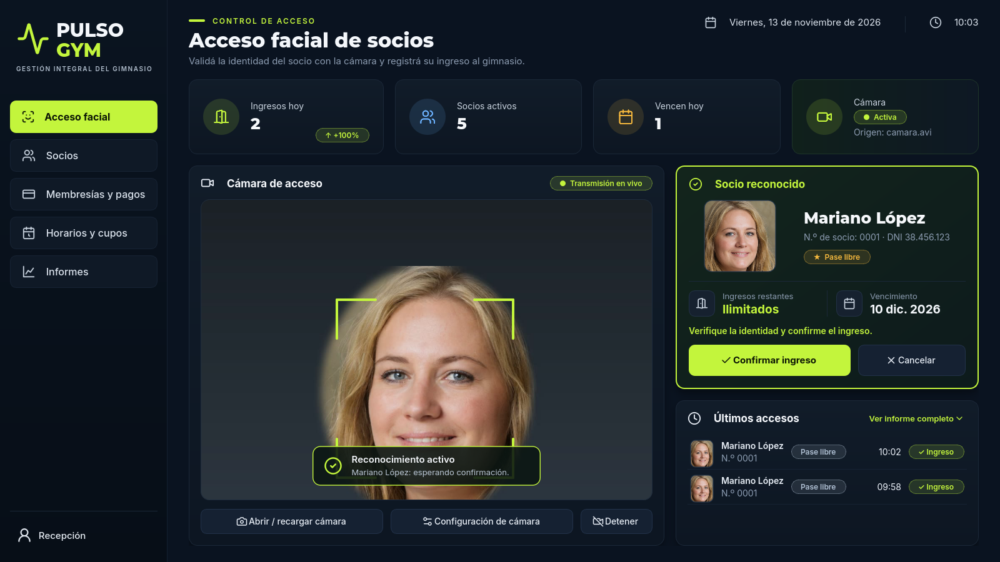

# PULSO GYM · Control de acceso por reconocimiento facial

Trabajo Final de Cursada — Reconocimiento Visual, IES N.º 7 Populorum Progressio.
Adaptación al **Contexto B: gimnasio** del proyecto local realizado hasta el Incremento 6.
Identidad ficticia: PULSO GYM.

## Empezar

1. Extraer todo el ZIP en una carpeta propia, por ejemplo `C:\proyectos\pulso-gym`.
2. Instalar **Python 3.12 de 64 bits** y **Docker Desktop** si todavía no están disponibles.
3. Ejecutar `instalar.bat`. Requiere Internet, crea `.venv` e instala las dependencias. La descarga de TensorFlow es grande.
4. Editar el nuevo `.env` y reemplazar `cambiar_clave_local` por una contraseña local antes del primer inicio de la base. No reutilizar el `.env` del sistema escolar.
5. Abrir Docker Desktop, esperar a que esté listo y ejecutar `iniciar.bat`.
6. En **Socios**, registrar una persona con DNI y tres fotos. En **Membresías y pagos**, registrar su pago y plan.
7. Revisar **Horarios**: inicialmente lunes a viernes de 07:00 a 22:00; sábado y domingo cerrados.
8. En **Acceso facial**, abrir la cámara. La primera inicialización de FaceNet512 puede descargar sus pesos y demorar. Revisar la terminal si falla; al terminar la descarga, volver a abrir la cámara.
9. Mirar a la cámara, revisar en el panel **Socio reconocido** la foto, el plan y el vencimiento, y elegir **Confirmar ingreso** (Enter) o **Cancelar** (Esc). Si nadie confirma en 45 segundos, se cancela sin registrar.

La aplicación es de escritorio, no una página web ni un ejecutable sin instalación. No incluye personas, fotografías, pagos, contraseñas reales, modelos descargados ni la carpeta `.venv`.

### Inicio manual en PowerShell

```powershell
py -3.12 -m venv .venv
.\.venv\Scripts\python.exe -m pip install -r requirements.txt
Copy-Item .env.example .env
# Editar .env antes de continuar.
docker compose up -d --wait
.\.venv\Scripts\python.exe main.py
```

Si `.env` ya existe, no repetir `Copy-Item`. Para detener únicamente esta base: `docker compose stop` desde esta carpeta. No borrar volúmenes del proyecto original.

## Interfaz

Tema oscuro con acento verde lima, barra lateral con iconos y cinco secciones. Todos los valores (KPIs, últimos accesos, gráficos, cupos) se calculan desde PostgreSQL; la aplicación no incluye datos de ejemplo. Las capturas de `docs/capturas/` se tomaron con socios de prueba en una base local y rostros sintéticos generados por IA (no son personas reales).

| Pantalla | Contenido |
|---|---|
| Acceso facial | Ingresos de hoy (con variación contra el mismo día de la semana anterior), socios activos, vencimientos del día, estado de la cámara, video con marco del rostro, socio reconocido con foto frontal, plan, ingresos restantes y vencimiento, confirmación/cancelación y últimos accesos |
| Socios | Búsqueda y filtros, ficha con foto y datos, alta y edición de datos o fotografías, historial de pagos y activación/desactivación |
| Membresías y pagos | Recaudación del mes, vigentes, por vencer y vencidas; registro de pago con aviso de renovación anticipada; uso del cupo por socio |
| Horarios y cupos | Estado abierto/cerrado, horas semanales, franjas por día y socios vigentes por plan |
| Informes | Rangos rápidos, ingresos por día, por hora y por plan, detalle y exportación Excel/PDF |

**Configuración de cámara** (en Acceso facial o en el menú *Recepción*) permite elegir la webcam por índice, un archivo de video o una URL; el valor se recuerda en el equipo y tiene prioridad sobre `CAMERA_INDEX`.



## Qué se implementó

| Área | Funcionalidad |
|---|---|
| Identificación | OpenCV + Haar Cascade + DeepFace/FaceNet512 reutilizados del proyecto original; inferencia en proceso separado |
| Socios | Alta, edición de datos y fotos, tres fotografías validadas (un rostro por foto), DNI único y activación/desactivación |
| Membresías | Pago, renovación, cambio de plan, historial de períodos y vigencia por mes calendario |
| Planes con cupo | 8, 12 o 20 ingresos por período, distribuidos libremente |
| Todos los días | Un ingreso por día local, incluso si se renueva durante ese día |
| Pase libre | Varios ingresos diarios; protección contra lecturas repetidas de 30 segundos |
| Horarios | Configuración por día, varios turnos y días cerrados; rechazo de superposiciones |
| Confirmación | Consulta sin escritura, panel con Confirmar/Cancelar (Enter/Esc, 45 s), cámara abierta y nuevas inferencias pausadas |
| Persistencia | PostgreSQL independiente; revalidación y bloqueo transaccional al confirmar |
| Informes | Historial por socio/fechas, estado actual, usados y restantes; Excel y PDF |

No hay salidas ni jornadas escolares: el gimnasio consume ingresos confirmados. No se conservó el login escolar porque la consigna B plantea una estación de recepción administrada. Esta versión no implementa roles ni autenticación administrativa; debe usarse como proyecto académico en una estación controlada.

## Base independiente

| Recurso | Valor |
|---|---|
| Stack | `asistencia-gimnasio` |
| Base | `asistencia_gimnasio` |
| Volumen | `asistencia-gimnasio_pgdata` |
| Puerto del equipo | `5433` |
| Puerto del contenedor | `5432` |
| Zona horaria | `America/Argentina/Buenos_Aires` |

El esquema está en `database/initdb/01-schema.sql`. Docker lo ejecuta solamente al crear un volumen vacío. Cambiar el archivo SQL después no modifica una base ya inicializada. Para cambiar la clave de una base existente hay que cambiarla también dentro de PostgreSQL; editar `.env` por sí solo no la cambia.

## Decisiones de negocio

- **Vigencia:** `[inicio, vence)`. Un pago del 20/10 permite ingresar hasta el 19/11 inclusive; el 20/11 requiere renovación. Se trabaja por fechas locales, no por 30 días ni por la hora exacta del pago.
- **Días 29, 30 y 31:** se conserva el día si existe en el mes siguiente; de lo contrario se usa su último día. El 31/01/2026 vence el 28/02/2026. El 31/01/2028 vence el 29/02/2028.
- **Renovación anticipada:** comienza hoy, cierra el período anterior y pierde su saldo. La pantalla advierte antes de confirmar. No se acumulan cupos ni se crean dos membresías abiertas.
- **Renovación el día del vencimiento:** genera un nuevo mes desde ese día.
- **Cambio de plan:** se aplica al nuevo período. Los ingresos históricos mantienen la relación con su plan original.
- **Planes 2/3/5 veces:** el nombre es comercial; no se impone límite semanal ni diario adicional. Se controla exclusivamente el cupo mensual y el antirrebote.
- **Repetición:** 30 segundos desde un ingreso persistido para cualquier plan. Después de cerrar el modal se suprimen nuevas propuestas al mismo socio durante 10 segundos; Cancelar no consume cupo ni escribe en la base.
- **Horario:** apertura inclusiva y cierre exclusivo. Varias franjas por día; sin franjas significa cerrado. No se aceptan franjas que crucen medianoche; esta versión no administra feriados excepcionales.
- **Confirmación concurrente:** se bloquea el socio y se vuelven a validar vigencia, estado, horario y cupo; un UUID evita repetir la misma solicitud. Si el plan cambió con el modal abierto, se pide una nueva identificación.
- **Rechazos:** visibles en pantalla; no se persisten como auditoría. La consigna admite que ese registro sea opcional.

Más análisis, guion de defensa y límites en `docs/DEFENSA.md`.

## Modelo de datos

Abrir `docs/DER.svg` en el navegador para ver el diagrama. `docs/DER.md` contiene su explicación y versión Mermaid.
El SQL está listo para importar en DrawSQL. **No se creó ni publicó un diagrama en una cuenta de DrawSQL**: para cumplir la entrega formal, importar allí el esquema PostgreSQL, revisar las relaciones y guardar/exportar el DER. El archivo local no se presenta como una exportación de DrawSQL.

## Pruebas

```powershell
.\.venv\Scripts\python.exe -m unittest discover -s tests -v
# Con la base configurada y encendida:
$env:TEST_POSTGRES='1'
.\.venv\Scripts\python.exe -m unittest discover -s tests -v
Remove-Item Env:TEST_POSTGRES
```

Las pruebas de base crean un esquema de nombre aleatorio, lo prueban y eliminan únicamente ese esquema. No borran tablas existentes. Sin `TEST_POSTGRES=1`, las diez pruebas de base se omiten explícitamente.

Ver `docs/VALIDACION.md` para los resultados reales y las verificaciones todavía manuales.

## Git y entrega académica

El ZIP incluye `historial.bundle`: un repositorio portátil con `main` (copia local del código recibido, sin datos privados) y `adaptacion-gimnasio` (cambios de esta adaptación). Ese historial **no es el historial original de GitHub**: su primer commit identifica explícitamente la copia local. El repositorio y los datos originales en `C:\proyectos` se conservaron sin modificaciones.

Para restaurar la copia versionada, desde la carpeta extraída:

```powershell
git clone historial.bundle ..\pulso-gym-versionado
cd ..\pulso-gym-versionado
git switch adaptacion-gimnasio
```

Si el docente exige la rama dentro de tu repositorio original, partir de su `main` terminado, crear `adaptacion-gimnasio` e incorporar estos cambios (incluyendo las eliminaciones de pantallas/tablas escolares). No reemplazar ni borrar `main`. Conservar tu autoría e historial originales.

**Pendientes externos de entrega:** publicar la rama en tu GitHub y guardar el DER en DrawSQL. No se hizo ningún push ni publicación desde esta preparación del ZIP. La guía de la consigna se utilizó como requisitos del proyecto, no como autorización para publicar en tus cuentas.

## Problemas frecuentes

- **Docker no responde:** abrir Docker Desktop y esperar a que termine su inicio.
- **Puerto ocupado:** cambiar `POSTGRES_PORT` en `.env`; se aplica tanto a Docker como a la conexión de Python.
- **Webcam ocupada:** cerrar otras aplicaciones y elegir otra cámara en **Configuración de cámara** (o `CAMERA_INDEX`).
- **Sin referencias válidas:** usar fotos iluminadas con un único rostro, tamaño suficiente y giro lateral leve; volver a abrir/recargar la cámara después de registrar al socio.
- **Motor demora o falla:** revisar Internet para la descarga inicial de pesos y el detalle en la terminal. La carga tiene un máximo de tres minutos por intento.
- **No permite ingresar:** revisar el mensaje, estado del socio, vigencia, saldo y horario del día.
- **Instalación:** usar Python 3.12 de 64 bits. `requirements.txt` conserva las versiones del entorno del proyecto recibido, utilizadas para validar la adaptación; la instalación desde cero requiere que esas versiones estén disponibles en el índice de paquetes.

El reconocimiento conserva el umbral coseno 0,40 del proyecto base. No incluye detección de vida ni fue evaluado como control de seguridad comercial. La verificación real de precisión con la webcam y los socios de la demostración debe realizarse antes de exponer.
