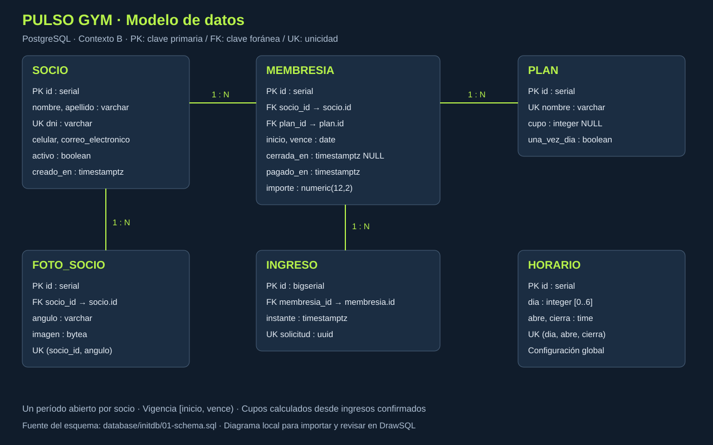
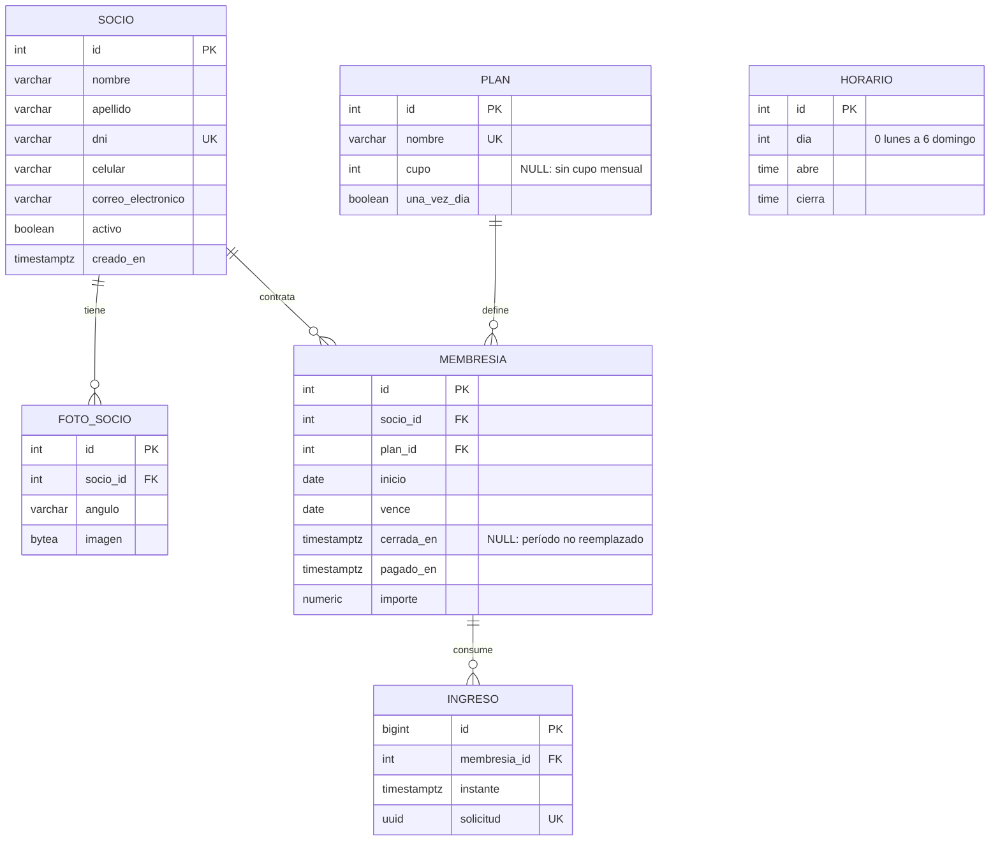

# Modelo de datos · PULSO GYM

## Justificación

- El socio conserva identidad y datos de contacto aunque deje de tener una membresía vigente.
- Cada socio dispone de hasta una fotografía por ángulo, con unicidad `(socio_id, angulo)`. El alta de la aplicación exige las tres en una transacción.
- El catálogo de planes contiene los cinco planes obligatorios. Es fijo en esta versión: no se edita un plan ya utilizado y así se preserva el significado histórico de sus cupos.
- Una membresía representa un pago y su período. No se implementan cuotas parciales ni medios de pago; el importe y el instante del pago quedan registrados en esa entidad.
- El índice parcial `una_membresia_abierta` permite múltiples períodos históricos, pero solo uno no reemplazado por socio. Una membresía puede estar vencida y seguir abierta: su vigencia se evalúa por fechas.
- El ingreso apunta a la membresía, no duplica el socio ni el plan. El historial se reconstruye mediante esas relaciones. El UUID único evita duplicar una confirmación reintentada.
- Los horarios son configuración global. No necesitan una relación con cada socio; se aplican a todos los accesos.
- Los cupos se calculan contando ingresos persistidos, evitando almacenar un contador que pueda desincronizarse.
- No hay borrado en cascada de historias. Los socios se desactivan, no se eliminan.

## DrawSQL

Importar `database/initdb/01-schema.sql` como esquema PostgreSQL, comprobar las cuatro relaciones y guardar el diagrama en la cuenta usada para la materia. El DER local es documentación del esquema implementado; no se afirmó haber creado un archivo dentro de DrawSQL.
